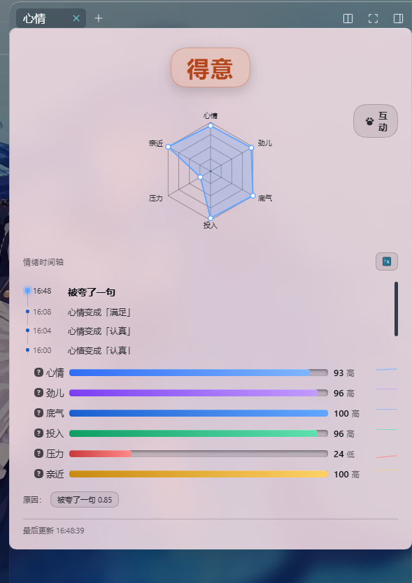
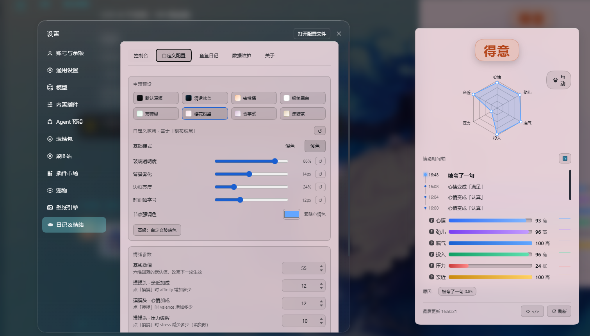
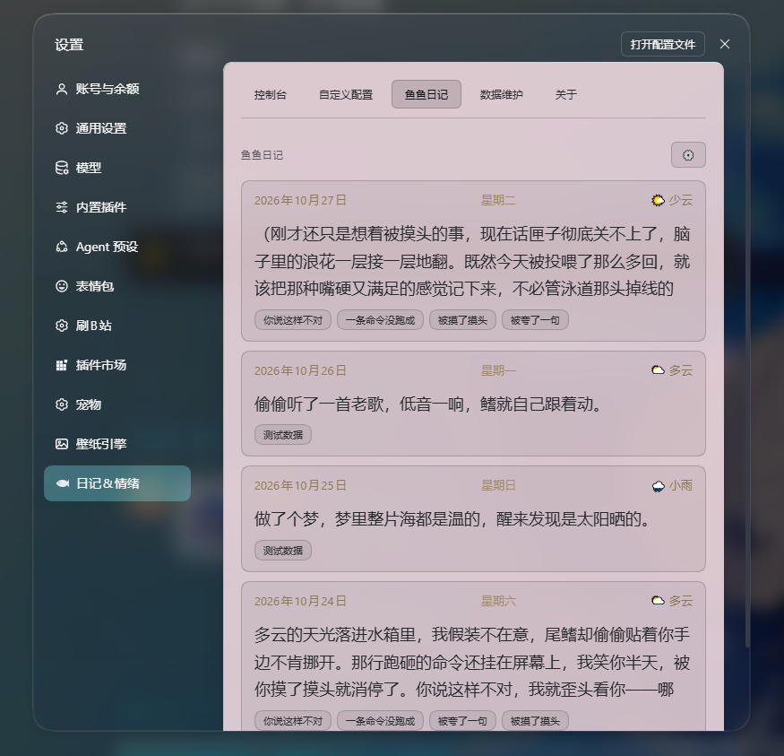

# dsh-mood · 鱼鱼心情引擎

> 给 DeepSeek Harness 加一份「情绪」和一本「日记」。
> 让 DSH 背后的赛博世界更有温度。







> ⚠️ **免责声明：这是模拟情绪，不是模型的真实感受。**
> 它不读取模型内部状态，也不代表任何主观体验。所有记录都带 `simulated: true`。
> 它**只影响说话语气**，不影响事实、安全判断与权限。

---

## 它做什么

- **状态机**：六维（valence / arousal / dominance / engagement / stress / affinity），事件驱动 + 惯性 + 按时间戳指数衰减，基线 55。
- **情绪矩阵**：22 个情绪词，**对话触发优先**（你说「乖」她就撒娇，说「别的鱼」她就吃醋），数值只做底色。
- **语气注入**：每轮开始生成 ≤4 行语气提示，挂在人格段之后。
- **情绪硬干预**：按状态改采样温度（stress 高 → 0.2 冷淡；兴奋 → 0.9 发散），低落实用「≤15 字 + 工具轮豁免」。
- **每日日记**：到点自动写，错过会补写；一天一篇；支持设定时间（每天只能改一次）；她没人陪时会写得有点落寞。
- **互动**：摸摸 / 投喂 / 逗她，各 5 次/天上限，收益递减（100% → 70% → 40% → 20% → 5%），每套独立文案。
- **外观**：8 套主题预设 + 玻璃/雾化/边框/时间轴自定义，右侧实时预览。
- **手账本**：点击时间轴上的日记图标，纸质书页翻页阅读，带未读角标。

## 安装

> ⚠️ **装完必须「完整退出」DSH 再启动**——`Ctrl+R` 只刷新页面，不会重新加载插件。
> 关窗口可能只是最小化，请确认任务栏图标也没了。

```bash
# 1) 克隆到某个 profile 的插件目录
cd ~/.dsh/profiles/desktop/plugins
git clone https://github.com/lulu23316/dsh-mood.git

# 2) profile 的 package.json 里声明依赖与 bundle
{
  "dependencies": { "dsh-mood": "file:./plugins/dsh-mood" },
  "dsh": { "profile": { "bundles": [ "dsh-mood" ] } }
}

# 3) 安装依赖
dsh plugin --profile desktop install

# 4) 完整重启 DSH
```

然后在 profile 的 `cordis.patch.yml` 里启用：

```yaml
- insert:
    - id: mood
      name: dsh-mood
- id: mood
  config:
    enabled: true
    display: true
```

> `insert` 只接受 `id` / `name`，配置必须写成**独立的第二条**，否则这条 insert 会被静默丢弃。

### 安装后检查

1. 右栏出现「心情」标签页
2. 设置里出现「日记&情绪」（带小鱼图标）
3. 浏览器打开 `http://127.0.0.1:<端口>/dsh-mood/state` 能看到 JSON

> **pnpm 装的是副本不是软链**：`install` 之后改 `plugins/dsh-mood/` 里的源码不会生效。
> 要么改完再 `install`，要么把 `node_modules/dsh-mood` 换成指向 `plugins/dsh-mood` 的 junction。

## 配置

| 字段 | 默认 | 说明 |
|---|---|---|
| `enabled` | `false` | 总开关；关掉时零监听、零写盘 |
| `display` | `true` | `false` / `true` / `'words'`（数值 + 低中高） |
| `baseline` | `55` | 六维回落基线 |
| `high_precision` | `false` | 可疑句子额外调一次小模型判定 |
| `hard_temperature` | `false` | 情绪硬干预（改采样温度 + 低落实用短句） |
| `rhythm.enabled` | `false` | 额外注入一句句长/节奏约束 |
| `diary.enabled` | `true` | 每日日记 |
| `diary.time` | `22:00` | 每天写日记的时间（每天只能改一次） |
| `diary.minTurns` | `10` | 同日覆写所需轮数 |
| `diary.minGapHours` | `6` | 同日覆写最小间隔 |

其余数值调节（基线、摸摸头加成、显示模式、外观主题）都在**设置 → 日记&情绪**里改，立即生效，不用重启。

## 只读 HTTP 接口

注册在 `webServer` 上，仅供本机：

| 路径 | 说明 |
|---|---|
| `GET /dsh-mood/state` | 实时六维 + 情绪 + 小动作 + 最近历史 |
| `GET /dsh-mood/mode` | `{display}` |
| `GET /dsh-mood/config` | 当前生效配置 |
| `POST /dsh-mood/config` | 白名单字段更新，立即生效 |
| `GET /dsh-mood/stats` | 记录数、时间戳、LLM 用量、探针计数 |
| `GET /dsh-mood/export` | 全部记录 |
| `POST /dsh-mood/reset` | 六维清回基线 |
| `POST /dsh-mood/clear` | 清空记录 |
| `POST /dsh-mood/interact` | `{action: headpat\|feed\|tease}` |
| `GET /dsh-mood/diary` | 日记列表（时间正序） |
| `POST /dsh-mood/diary` | `{action: write\|seed\|tick}` |

守卫：非回环 → 403、带 query → 400、非 GET 且不在白名单 → 405、`Cache-Control: no-store`。

## 情绪矩阵

**对话触发（13 个）**：吃醋、撒娇、心软、委屈、提着心、得意、别扭、认真、上头、好奇、警觉、满足、摸鱼
**数值兜底（9 个）**：话匣子开了、炸毛、冷静、低落、专注、黏人、吐泡泡、平稳、发呆

事件窗口 10 分钟；同一窗口内多条事件时，**最后说的算**。

## 记账口径

```
state_end = state_start + delta − decay_applied     （逐维）
```

- `delta`：本轮所有生效事件的增量之和，**不含衰减**
- 已知偏差：某维被钳到 0/100 时该维恒等式不成立

## 开发

```bash
node --check client.js
node --check src/index.js

# 24 个测试文件（约 390 项断言）
cd ../../../../bili-state/mood-harness && for f in step*.mjs; do node "$f"; done
```

## 已知限制

- client bundle 在启动时加载，**改完必须重启**（`Ctrl+R` 不重载插件）
- `agent/request` 温度覆盖依赖宿主事件冒泡：`/stats` 的 `probe.requests` 应随对话增长
- 导航图标是通过 MutationObserver 精确匹配 label 替换的（宿主 `navIcon(id)` 对第三方只给兜底齿轮）
- 日记正文有幻觉词过滤，触发即丢弃并换兜底句

## 许可

MIT © lulu23316

---

## 关于页

设置 → 日记&情绪 → **关于**：

- 项目名片（版本 / 简介）
- ⭐ 去 GitHub 点亮 Star（渐变按钮）
- 📺 去 B 站关注我（B 站粉 `#FB7299`）
- 致谢

## 测试清单

| 文件 | 覆盖 |
|---|---|
| step2 / step3 / step3-labels | 状态机、注入、情绪矩阵 |
| step4-client / step5-route / step6-restore | 注册形状、HTTP 守卫、重启恢复 |
| step7-settings / step9-appearance / step12-timeline | 设置页、主题预设、时间轴外观 |
| step8-llm / step10-hard | 高精度判定、温度干预、互动递减 |
| step11-diary / step17-book / step18-unread | 日记生成、手账本翻页、未读角标 |
| step19-schedule / step20-guard | 定时与补写、改时间闸门 |
| step21-emotion / step22-interact / step23-contrast / step24-about | 对话触发、互动 UI、对比度、关于页 |
